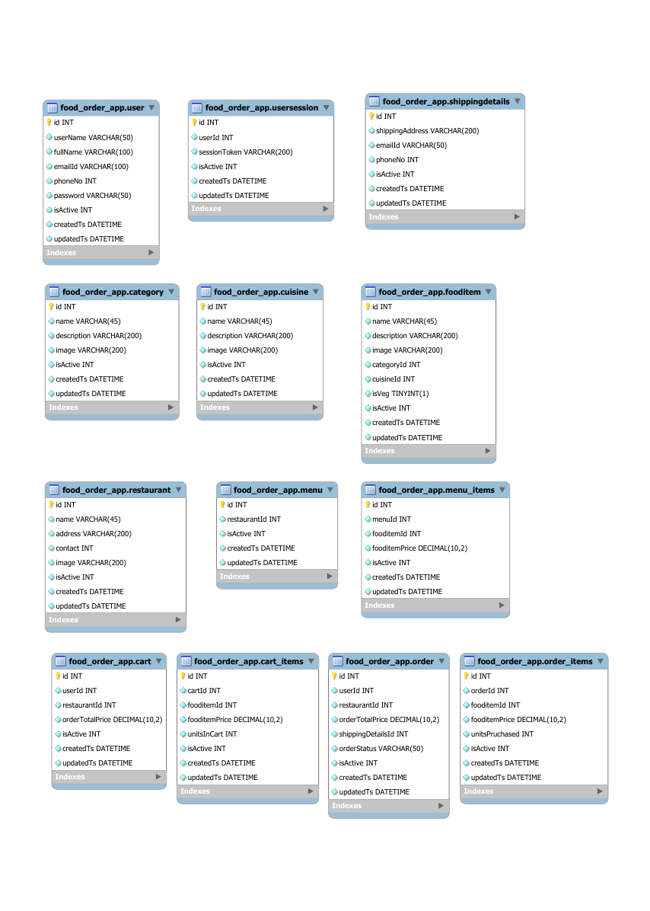
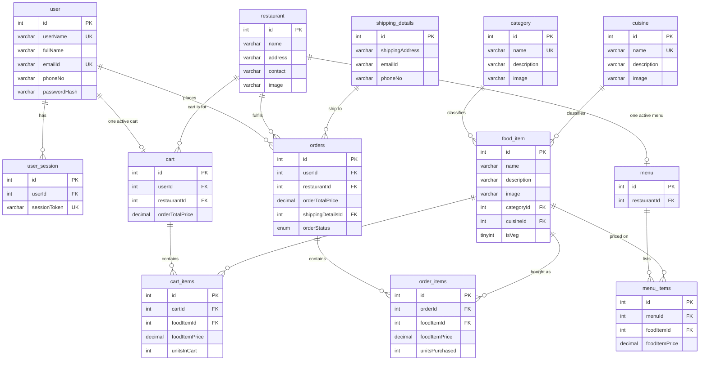

# Food Order App: SQL Database (MySQL 8)

Relational schema, sample data and SELECT queries for a food-ordering domain: users, restaurants, menus, carts and orders in 13 tables.

## Overview

This began as a Great Learning full-stack program coursework assessment (SQL modules 1 and 3): design the database for a food-ordering app, write the DDL, load sample data, and answer a set of SELECT questions. It is one part of a series built around the same "Food Order App" domain; the same data is modelled again as MongoDB collections in [`../08-nosql-mongodb-database`](../08-nosql-mongodb-database).

This folder contains the cleaned-up version of that submission. The original files are the starting point; what I changed is listed under [Improvements over the original assessment version](#improvements-over-the-original-assessment-version).

## Schema



*The diagram above is the original Workbench export as submitted (also in [`docs/ER-diagram.pdf`](docs/ER-diagram.pdf)). It predates the foreign keys and renames described below, so it shows no relationship lines. The diagram below is written from the current `schema/01_schema.sql`.*



Every table also has `isActive` (soft delete flag, default 1), `createdTs` and `updatedTs` (omitted from the diagram for readability).

Design notes:

- **Prices are copied** onto `cart_items` and `order_items`, so an order keeps the price paid even if the menu price later changes. `menu_items` holds the current price per restaurant.
- **"One active" rules** are enforced with unique functional indexes: a restaurant has at most one *active* menu, and a user at most one *active* cart, while any number of inactive rows can be kept as history.
- **Soft delete**: rows are flagged `isActive = 0` rather than deleted, which is why no foreign key uses `ON DELETE CASCADE`.
- The full written design (column lists, purposes, relationships) is in [`docs/database-design.pdf`](docs/database-design.pdf), as submitted.

## Getting started

Requires MySQL 8.0.16 or later (CHECK constraints are enforced from 8.0.16, functional indexes exist from 8.0.13).

```bash
# from this folder; creates database food_order_app (drops and recreates its tables)
mysql -u <user> -p < schema/01_schema.sql
mysql -u <user> -p < schema/02_seed_data.sql
mysql -u <user> -p < queries/01_basic_selects.sql
mysql -u <user> -p < queries/02_joins_and_aggregates.sql
```

Or open the files in MySQL Workbench and run them in that order. Each query in `queries/` has a comment with the question and the result expected on the seed data.

To re-run the offline smoke test (Python 3 standard library only, no MySQL needed; see Status for what it does and does not prove):

```bash
python3 scripts/validate_with_sqlite.py
```

## Project structure

```
07-sql-database/
├── schema/
│   ├── 01_schema.sql                 # database + 13 tables, keys, indexes, checks
│   └── 02_seed_data.sql              # demo data (3 users, 10 restaurants, 20 food items, ...)
├── queries/
│   ├── 01_basic_selects.sql          # 10 filtering / LIKE / ORDER BY / aggregate queries
│   └── 02_joins_and_aggregates.sql   # 5 join + GROUP BY queries
├── scripts/
│   └── validate_with_sqlite.py       # offline smoke test (SQLite stand-in)
└── docs/
    ├── ER-diagram.pdf                # original Workbench ER export
    ├── er-diagram.png                # same diagram as an image
    └── database-design.pdf           # original design document
```

## What I practised

- Designing a normalised relational model (lookup tables, junction tables such as `menu_items`, header/detail pairs such as `orders` / `order_items`) and documenting it with an ER diagram and design document.
- Writing MySQL DDL: data types, primary and foreign keys, unique and composite indexes, defaults, soft-delete columns.
- Writing SELECT queries: `LIKE`, `DISTINCT`, `ORDER BY ... LIMIT`, `GROUP BY` with `COUNT` / `SUM`, inner and left joins across three to four tables.
- Reading schema and queries against each other: most of the work on the query files was reconciling names with the real schema.
- Checking data consistency (cart and order totals against their line items).

## Improvements over the original assessment version

The submission had two schema versions: `SQL1` (with foreign keys and wider column types) and the later `SQL3` (the course's template DDL, with no foreign keys, `int` phone columns and a different unique-key idea), plus two query files that only exist in `SQL3`. I kept SQL3's data and table design as the base and brought over SQL1's foreign keys.

Schema:

- Added the missing **foreign keys** (SQL3 had none) with named constraints and **indexes** covering every foreign key column (some through composite unique keys), plus `orders.updatedTs`.
- Ids are `AUTO_INCREMENT`; `updatedTs` now refreshes automatically (`ON UPDATE CURRENT_TIMESTAMP`).
- `phoneNo` and restaurant `contact` were `INT` (loses leading zeros, overflows on real numbers); now `VARCHAR(20)`.
- `password varchar(50)` became **`passwordHash varchar(255)`**; the seed data holds obviously fake bcrypt-shaped placeholders instead of `password123`-style plaintext.
- Added unique keys on `userName`, `emailId`, session token and category / cuisine names, and `CHECK` constraints for flags, prices and quantities. `orderStatus` is an `ENUM`.
- Replaced `UNIQUE (restaurantId, isActive)` and `UNIQUE (userId, isActive)` (which also limited a restaurant or user to a single *inactive* row) with functional indexes that only constrain active rows.
- Consistent naming: tables renamed `usersession` to `user_session`, `fooditem` to `food_item`, `shippingDetails` to `shipping_details`, `order` to `orders` (avoids the reserved word); columns `fooditemId` / `fooditemPrice` to `foodItemId` / `foodItemPrice`.
- The script can be re-run (drops tables, not the whole database) and has no leftover template comments.

Data:

- All 20 food items were flagged vegetarian (`isVeg = 1`), including chicken, prawn and salmon dishes; seven are now `0`.
- Order 2 had a 2022 timestamp while its items said 2023 (typo); order 3's item price (10) did not match its total (90 for 3 units, menu price 30). Both fixed so totals reconcile. Fixed the "Cheescake" typo.

Queries (`SelectQueries1.sql` / `SelectQueries2.sql`): the originals referenced tables and columns that do not exist in the DDL (`Cuisine.cuisine_name`, `FoodItem.is_vegetarian`, `Menu.price`, `Orders.total_price`, `OrderItems.quantity`, `Users`, `CartItems`, ...), so most would have failed. Every query was rewritten against the real schema, now carries its question and the expected result, and is valid under MySQL 8's default `ONLY_FULL_GROUP_BY`. Small semantic fixes: query 5 of the first file used a non-existent `Menu.price` and now joins `menu_items` and `restaurant`; the cart total uses the price stored on `cart_items`; per-cuisine / per-category counts use `LEFT JOIN` so empty groups show 0.

## Known limitations / next steps

- `orderTotalPrice` on `cart` and `orders` is stored redundantly (it should equal the sum of the line items) and is not kept in sync by the database; a real app would compute it in a transaction or with a view.
- Prices are not validated against `menu_items` by any constraint, and the "cart items must belong to the cart's restaurant" rule is not enforced.
- `sessionToken` is stored as given; a real system would store a hash of the token and add an expiry column.
- The seed data is tiny (3 users, 3 orders), so the queries are exercises rather than a performance test.
- The ER PDF and design PDF are the originals and still show the old column names and types.

## Status

- Verified here: `scripts/validate_with_sqlite.py` translates the MySQL scripts to SQLite (strips ENGINE / CHARSET / AUTO_INCREMENT / ON UPDATE, rewrites ENUM and the key lines) and runs schema, seed data and all 15 queries with foreign keys enabled. All checks passed: 13 tables created; seed data loads with no foreign-key violations; cart and order totals equal the sum of their lines; the one-active-menu and one-active-cart rules, `CHECK` constraints and the enum are enforced; every query runs and returns the results noted in its comment.
- Not verified: **the scripts were not run on a real MySQL 8 server** (none was available and a package install was not possible in the sandbox). SQLite is more permissive than MySQL (no `ONLY_FULL_GROUP_BY`, loose typing), and the functional unique indexes, `utf8mb4_0900_ai_ci` collation and `ON UPDATE CURRENT_TIMESTAMP` behaviour are only checked by reading, not by execution. Expect to run it once on MySQL 8 before relying on it.
