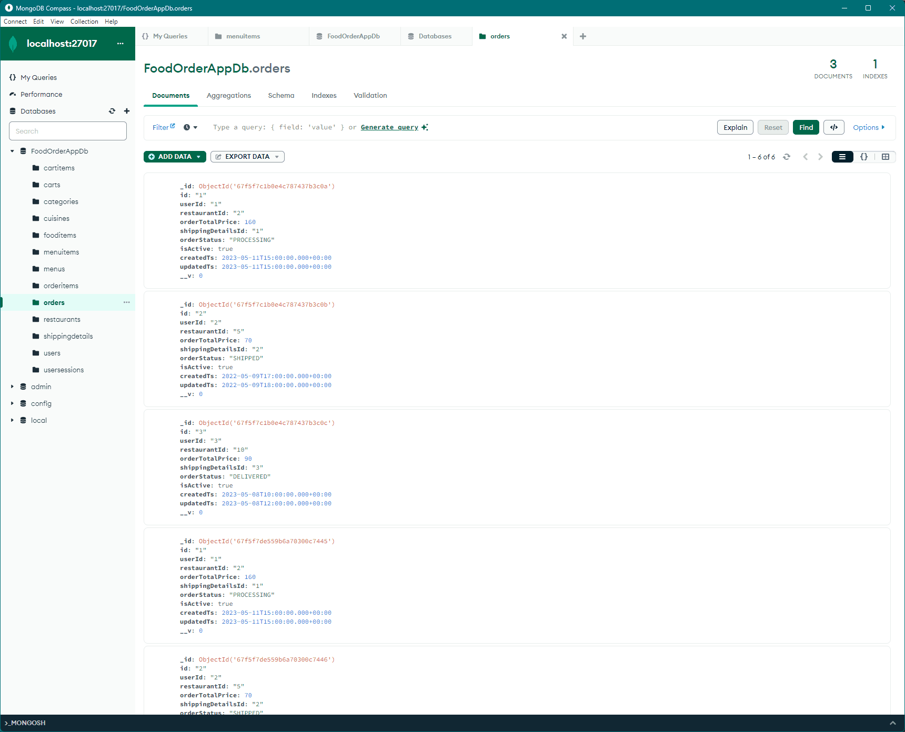

# Food Order App: NoSQL Database (MongoDB)

The Food Order App data modelled as 13 MongoDB collections, with a `mongosh` seed script and ten retrieval queries.

## Overview

This began as a Great Learning full-stack program coursework assessment on MongoDB: create collections for the Food Order App, insert documents, and answer a set of retrieval questions. The original submission was a **Word document** containing Compass screenshots of each collection (Task 1) and the `mongosh` queries (Task 2). This folder turns that into runnable files: a seed script that recreates the documents, the queries as a script, and a description of the model. It is the NoSQL counterpart of [`../07-sql-database`](../07-sql-database), which models the same domain relationally.

The Compass screenshots from the submission are kept in [`docs/screenshots`](docs/screenshots) (the users screenshot has the plaintext demo passwords blacked out).



## Data model

Thirteen collections in database `FoodOrderAppDb`: `users`, `usersessions`, `categories`, `cuisines`, `restaurants`, `fooditems`, `menus`, `menuitems`, `carts`, `cartitems`, `shippingdetails`, `orders`, `orderitems`.

Every collection is flat (no embedded sub-documents) and documents point at each other by a string `id` field. Fields, relationships, a Mermaid diagram and example documents are in [`schema/collections.md`](schema/collections.md).

## Features

- Seed script that drops and re-creates the 13 collections, inserts the demo documents and creates indexes.
- Ten queries covering `distinct`, filtering, projection, range and date comparison, sorting with `limit`, `countDocuments`, an aggregation pipeline, and multi-step lookups across collections.
- Written for `mongosh`; no application code or driver needed.

## Tech stack

MongoDB (document database), `mongosh` scripts (JavaScript). Collections were originally browsed in MongoDB Compass.

## Getting started

Requires a running MongoDB server (for example `mongod` on `localhost:27017`) and `mongosh`.

```bash
# from this folder
mongosh "mongodb://localhost:27017" seed/seed.js      # creates database FoodOrderAppDb
mongosh "mongodb://localhost:27017" queries/queries.js
```

The seed script only drops and recreates its own 13 collections in `FoodOrderAppDb`. Each query in `queries/queries.js` has a comment with the question and the result expected on the seed data. See Status: these `mongosh` commands were not run against a real server in the sandbox where this was prepared.

## Project structure

```
08-nosql-mongodb-database/
├── seed/seed.js            # recreates the collections and documents
├── queries/queries.js      # Task 2 queries (fixed), with expected results
├── schema/collections.md   # fields, relationships, Mermaid diagram, indexes
└── docs/screenshots/       # Compass screenshots from the original submission (13 images)
```

## Queries

1. Distinct category names
2. Vegetarian food items
3. Name and address of every restaurant
4. Orders with a total between $75 and $150
5. Orders created after 10 May 2023
6. Food items of the Italian cuisine
7. Menu items at the restaurant "Gourmet Junction" (restaurant, then its menu, then the menu's items)
8. The order with the lowest total
9. How many menu items there are for "Veg Pizza"
10. The cart with the most food items (aggregation)

## SQL model vs. MongoDB model

The two folders hold the same 13 entities, and the MongoDB version is a nearly one-to-one translation: each table became a collection and each foreign key became a string `id` reference. That is the simplest thing that works and it makes the two easy to compare, but it does not use what MongoDB is good at. Questions such as "menu items at Gourmet Junction" need three sequential lookups here, where SQL does one `JOIN` and the database enforces that every reference exists; MongoDB checks neither, so a stray `restaurantId` is accepted silently. A more idiomatic document design would embed what is read together and rarely changes on its own: `menuitems` inside `menus` (or menu items with a denormalised food item name), `cartitems` inside `carts`, and `orderitems` plus a shipping-address snapshot inside `orders`, which also suits orders because they should keep the prices and address from the moment they were placed. The cost of embedding is duplicated data (a food item's name in many menus) and larger documents to rewrite when something changes, while the gain is single-read access for the common screens (view menu, view cart, view order). The relational version stays the better fit for ad-hoc reporting across entities (for example revenue per cuisine), which in MongoDB would need `$lookup` pipelines.

## What I practised

- Translating a relational design into collections and deciding what to reference versus embed.
- Inserting documents with `insertMany` and shaping them (booleans, dates, numbers, business keys).
- Querying with `find` / `findOne` filters, projection, `$gte` / `$lte` / `$gt` operators, `sort` / `limit`, `distinct`, `countDocuments` and `aggregate` with `$group`.
- Working across collections without joins by chaining lookups.
- Debugging a type mismatch: references stored as strings but queried with an ObjectId.

## Improvements over the original assessment version

- **Runnable seed script** replacing screenshots-only evidence, with indexes (unique `id` everywhere).
- **Query fixes.** The submitted queries compared reference fields (strings such as `"7"`) with `_id` ObjectIds, so queries 6, 7 and 9 would have returned nothing or failed on a `null`; they now use `.id`. `findOne()` results are checked for `null` with a clear error instead of throwing a `TypeError`. The aggregation has a deterministic tie-break. Results are printed (a script file does not auto-print values the way the interactive shell does). Collection names use the actual lowercase names (`menuitems`, `cartitems`, ...) consistently; the assessment headings wrote `menuItems` / `cartItems`.
- **Hygiene.** Plaintext demo passwords replaced by clearly fake placeholder hashes in the seed data and blacked out in the published users screenshot.
- **Clean data.** The original contained each document twice (30 categories, 40 food items, ...), from running the load twice; the seed has one copy.
- Added documentation: collection reference with diagram, and this comparison to the SQL model.

## Known limitations / next steps

- References are plain strings with no integrity checking; a real app would use `ObjectId` references (or embedding, see above) and schema validation (`$jsonSchema`) on the collections.
- Order 2 is dated 2022 in the original screenshot while its order item is 2023 (probably a typo). It is kept as shown here; the SQL version corrects it.
- `phoneNo` and `contact` are numbers as in the original, which drops leading zeros; they should be strings.
- No application or driver code uses this database yet.

## Fidelity of the seed data

The screenshots show only the first few documents of each collection (Compass displays about three to five per screen, and the originals were doubled). I read those documents exactly: ids, field names, value types, timestamps and the orders / order items / carts / shipping data. For the remaining documents I used the dataset from the SQL assessment (`07-sql-database`), which the screenshots mirror one-to-one (same names, descriptions, prices and ids wherever both are visible). So the seed is a faithful reconstruction of the visible documents plus the SQL-derived remainder, not a verified copy of the original database. Two values are inferred rather than seen: the `isVeg` flags of items beyond the first four (taken as in the corrected SQL data; item 4, a chicken curry, shows `false` in the screenshot) and the price of order item 6.

## Status

- Verified: `node --check` passes on `seed/seed.js` and `queries/queries.js`. I also ran both scripts against a throwaway in-memory stand-in for the small part of the `mongosh` API they use (`getSiblingDB`, `insertMany`, `createIndex`, `find` / `findOne` / `distinct` / `countDocuments` / `aggregate` with sort / limit / projection). That run loaded all 13 collections (3, 3, 15, 10, 10, 20, 10, 25, 3, 8, 3, 3, 6 documents) and returned the results noted in the query comments (13 vegetarian items, 4 Italian items, 4 menu items at Gourmet Junction, 3 menu items for Veg Pizza, cart "1" with 4 items, and so on). The stand-in is not part of this repository, and it only shows that the scripts are free of runtime errors and that the string-`id` joins match the seeded data.
- Not verified: **the scripts were not run with real `mongosh` against a real MongoDB server.** No `mongod` was available, and `mongodb-memory-server` could not be installed because the package registry was unreachable from the sandbox. Behaviour of the real driver (for example index creation and date handling) is therefore untested.
