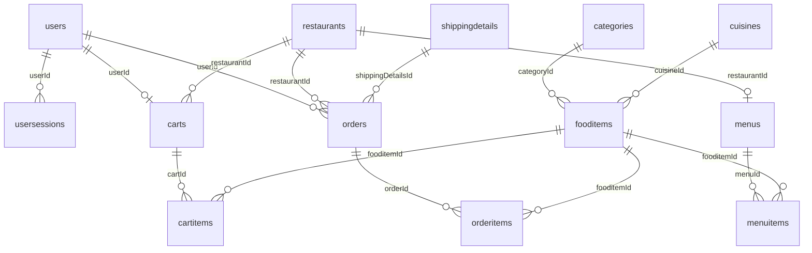

# Collections

Database: `FoodOrderAppDb`. 13 collections, created and populated by [`../seed/seed.js`](../seed/seed.js).
The collection names are the lowercase, pluralised names the original database used (Mongoose naming), which is what appears in the Compass screenshots in [`../docs/screenshots`](../docs/screenshots).

## Conventions

- Every document has MongoDB's own `_id` (ObjectId) **and** a string business key `id` (`"1"`, `"2"`, ...) carried over from the SQL tables. `id` has a unique index in every collection.
- **References use the string `id`**, not `_id`: `fooditems.cuisineId = "7"` points at the cuisine whose `id` is `"7"`. This is what the screenshots show. It means joins in queries use `.id` (the original queries used `._id`, which cannot match).
- Every document has `isActive` (boolean soft-delete flag), `createdTs` and `updatedTs` (`Date`).
- There are no database-enforced relationships: MongoDB does not check that a referenced `id` exists.

## Relationships



## Fields

Types are those of the seeded documents. `id`, `isActive`, `createdTs`, `updatedTs` and `_id` (see above) are on every collection and not repeated.

| Collection | Fields | References |
|---|---|---|
| `users` | `userName`, `fullName`, `emailId`, `phoneNo` (number), `passwordHash`, `isAdmin` (boolean) | |
| `usersessions` | `userId`, `sessionToken` | `userId` -> `users.id` |
| `categories` | `name`, `description`, `image` (URL) | |
| `cuisines` | `name`, `description`, `image` (URL) | |
| `restaurants` | `name`, `address`, `contact` (number), `image` (URL) | |
| `fooditems` | `name`, `description`, `image`, `isVeg` (boolean), `categoryId`, `cuisineId` | `categoryId` -> `categories.id`, `cuisineId` -> `cuisines.id` |
| `menus` | `restaurantId` | `restaurantId` -> `restaurants.id` |
| `menuitems` | `menuId`, `fooditemId`, `fooditemPrice` (number) | `menuId` -> `menus.id`, `fooditemId` -> `fooditems.id` |
| `carts` | `userId`, `restaurantId`, `orderTotalPrice` (number) | `userId` -> `users.id`, `restaurantId` -> `restaurants.id` |
| `cartitems` | `cartId`, `fooditemId`, `fooditemPrice`, `unitsInCart` | `cartId` -> `carts.id`, `fooditemId` -> `fooditems.id` |
| `shippingdetails` | `shippingAddress`, `emailId`, `phoneNo` (number) | |
| `orders` | `userId`, `restaurantId`, `orderTotalPrice`, `shippingDetailsId`, `orderStatus` (`PROCESSING` / `SHIPPED` / `DELIVERED`) | `userId` -> `users.id`, `restaurantId` -> `restaurants.id`, `shippingDetailsId` -> `shippingdetails.id` |
| `orderitems` | `orderId`, `fooditemId`, `fooditemPrice`, `unitsPurchased` | `orderId` -> `orders.id`, `fooditemId` -> `fooditems.id` |

## Example documents

```js
// fooditems
{ id: "4", name: "Nutty Chicken Curry", categoryId: "6", cuisineId: "2", isVeg: false, isActive: true,
  createdTs: ISODate("2023-12-12T17:18:03Z"), updatedTs: ISODate("2023-12-12T17:18:03Z"), /* description, image */ }

// menuitems: price of food item "4" on menu "1" (restaurant "1")
{ id: "2", menuId: "1", fooditemId: "4", fooditemPrice: 15, isActive: true, /* timestamps */ }

// orders
{ id: "1", userId: "1", restaurantId: "2", orderTotalPrice: 160, shippingDetailsId: "1",
  orderStatus: "PROCESSING", createdTs: ISODate("2023-05-11T15:00:00Z"), /* ... */ }
```

## Indexes created by the seed script

Unique on `id` (all collections) and on `users.userName` / `users.emailId`; non-unique on the reference fields used by the sample queries (`fooditems.cuisineId`, `menuitems.menuId`, `cartitems.cartId`, `orderitems.orderId`, ...), `orders.createdTs`, `orders.orderTotalPrice`.

## Differences from the original database

- The original held every document twice (each collection shows 2x the expected count, e.g. 30 categories, 40 food items) because the load was run twice; the seed inserts each once.
- Mongoose's `__v` field is not included.
- `users.password` held plaintext demo passwords (`password123`, ...); the seed has a `passwordHash` field with fake bcrypt-shaped placeholders instead.
- `fooditems`, `menuitems`, ... keep the original `fooditemId` / `fooditemPrice` spelling, whereas the cleaned-up SQL schema in `07` uses `foodItemId` / `foodItemPrice`.
