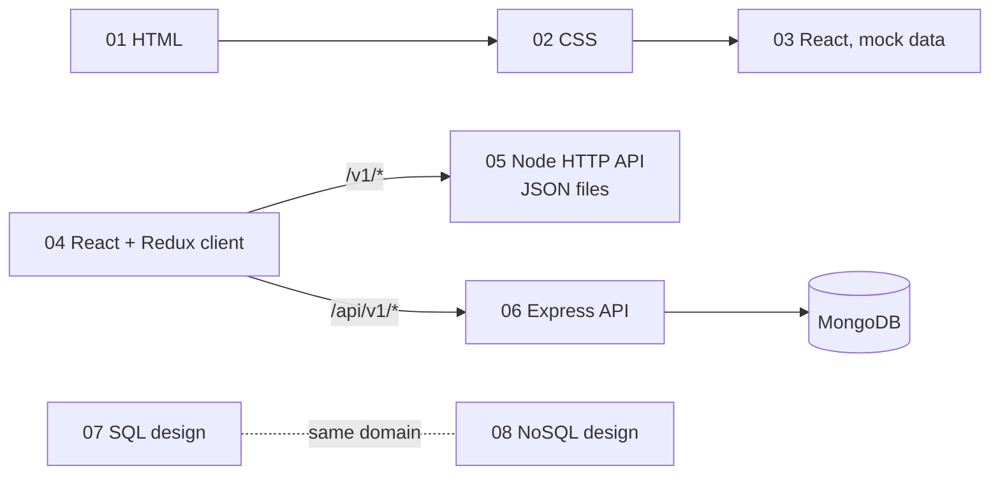

# Food Order App: a full-stack series

One application (a food-ordering app with an admin side), built layer by layer across eight stages: static HTML, CSS, React, a REST API in two flavours, and relational and document database designs.

Each folder is self-contained, with its own README, and can be run on its own.

| # | Folder | Layer | Stack |
| --- | --- | --- | --- |
| 1 | [`01-html-admin-pages`](01-html-admin-pages) | Page structure | semantic HTML |
| 2 | [`02-css-admin-dashboard`](02-css-admin-dashboard) | Styling and layout | CSS (flexbox, grid), responsive |
| 3 | [`03-react-frontend`](03-react-frontend) | UI with mock data | React, React Bootstrap |
| 4 | [`04-react-redux-frontend`](04-react-redux-frontend) | UI with a real API | React, Redux (thunk, persist), React Router, axios |
| 5 | [`05-node-http-api`](05-node-http-api) | Backend, no framework | Node `http` module, JSON files, `node:test` |
| 6 | [`06-express-mongodb-api`](06-express-mongodb-api) | Backend with a database | Express, MongoDB/Mongoose, JWT, bcrypt, mocha |
| 7 | [`07-sql-database`](07-sql-database) | Relational design | MySQL 8 schema, seed data, queries |
| 8 | [`08-nosql-mongodb-database`](08-nosql-mongodb-database) | Document design | MongoDB, mongosh scripts |

## How the pieces fit



Stages 1-3 are front-end only. Stage 4 is the same app talking to a backend, which can be either stage 5 (zero dependencies, easiest to run) or stage 6 (Express and MongoDB). Stages 7 and 8 are database designs for the same domain: restaurants, menus, food items, carts and orders.

## Run the full stack locally

```bash
# Terminal 1: the API (no install needed)
cd 05-node-http-api
npm start                 # http://localhost:8080

# Terminal 2: the React client
cd 04-react-redux-frontend
npm install
npm start                 # http://localhost:3000
```

The API's default CORS origin is `http://localhost:3000`, which is where the React dev server runs. See each project's README for the Express/MongoDB variant and for demo logins.

## Where these came from

These started as assessments in a Great Learning full-stack development course. The original submissions were close to the course templates (starter code, "complete the code here" comments, a Word document for the NoSQL stage). For this repository I kept the original solutions and improved them: bug fixes, security fixes (hard-coded secrets, plain-text passwords, HTML injection), tests, accessibility, and documentation. Each project's README lists what changed and what was and wasn't verified.

The sample data (users, restaurants, food items, player stats and so on) is demo data. Passwords and hashes in seed files are placeholders.
